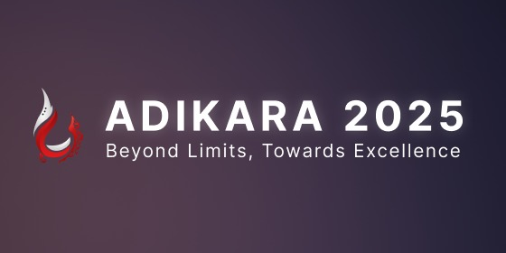
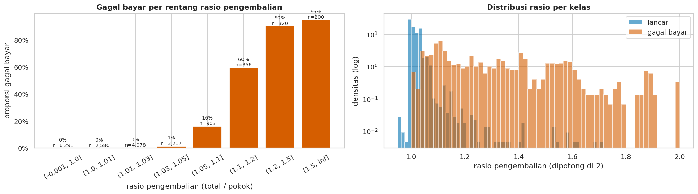
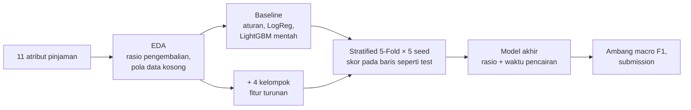
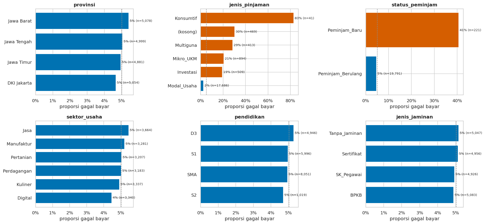
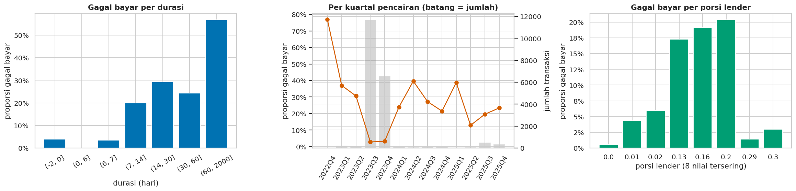
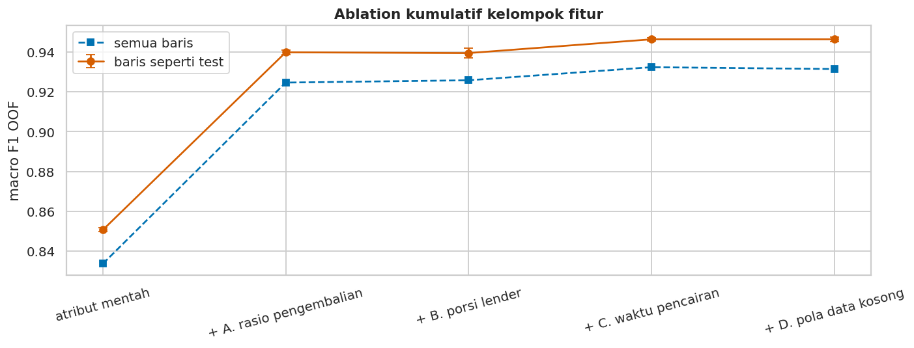
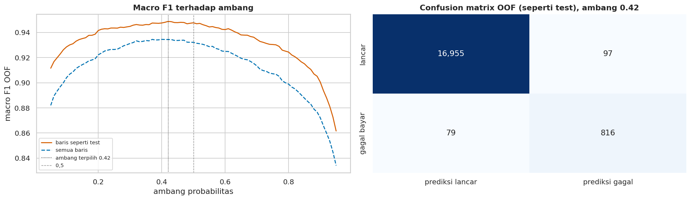
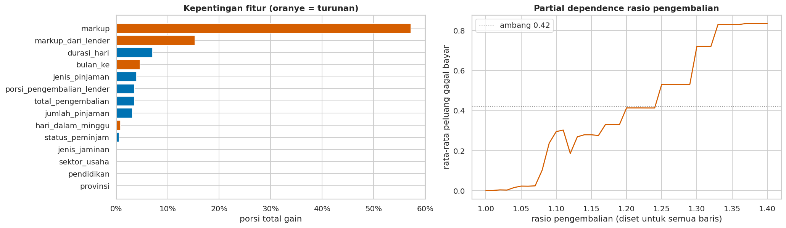

<p align="center">
  
  <br><sub>Gambar: halaman kompetisi <a href="https://www.kaggle.com/competitions/adikara-2025-indonesia-kredit-macet">ADIKARA 2025: Indonesian Credit Score</a> di Kaggle.</sub>
</p>

# Memprediksi Gagal Bayar Pinjaman UMKM: Sinyal Terkuat Ada di Rasio Pengembalian
### ADIKARA 2025 (Fakultas Informatika Telkom University) · Klasifikasi biner 20.012 pinjaman, metrik macro F1

**Dari data pinjaman digital, atribut apa yang paling membedakan pinjaman yang gagal bayar, dan apakah atribut itu
tersedia saat pinjaman diajukan?**

Proyek ini memprediksi `status_gagal_bayar` (5% dari data) dari 11 atribut pinjaman dan peminjam: provinsi, jenis
pinjaman, status peminjam, jumlah pinjaman, total pengembalian, durasi, porsi lender, sektor usaha, pendidikan, dan
jaminan. Analisis disusun seperti laporan riset: setiap keputusan pemodelan berasal dari temuan EDA, dan setiap temuan
dibuktikan dengan grafik.

**Temuan utama: total pengembalian dibagi pokok pinjaman menjelaskan hampir semuanya. Rasio ≤ 1,01 tidak pernah gagal
bayar, rasio di atas 1,2 gagal bayar 92%, dan fitur ini menaikkan macro F1 dari 0,851 menjadi 0,940. Model akhir
mencapai 0,947, tetapi tanpa atribut pengembalian skornya turun ke 0,667.**



---

## Ruang lingkup

- Eksplorasi atribut kategori, rasio pengembalian, durasi, waktu pencairan, porsi lender, dan perbedaan pola data kosong
  antara train dan test (adversarial validation).
- Baseline aturan, regresi logistik, dan LightGBM atribut mentah.
- Empat kelompok fitur turunan yang diuji dengan ablation kumulatif, pemilihan ambang untuk macro F1, dan model tanpa
  atribut pengembalian.
- Kepentingan fitur, partial dependence, dan analisis kesalahan.

Notebook asli dari masa kompetisi (Desember 2025) hilang. Seluruh analisis di repositori ini disusun ulang dari nol pada
November 2026 dan dijalankan penuh di Kaggle.

## Data dan desain eksperimen

| Data | Isi | Baris |
| --- | --- | ---: |
| `train.csv` | 11 atribut, tanggal pencairan, dan label `status_gagal_bayar` | 20.012 |
| `test.csv` | pinjaman yang diprediksi | 5.003 |

Total pengembalian kosong di 10,3% baris train tetapi hanya 1,1% baris test. Karena itu skor utama dihitung pada baris
train yang total pengembaliannya terisi ("seperti test"), memakai Stratified 5-Fold yang diulang dengan 5 seed. Ambang
probabilitas dipilih dari prediksi out-of-fold.



## Cerita dari data

### 1. Profil peminjam hampir tidak berpengaruh



Provinsi, sektor usaha, pendidikan, dan jaminan semuanya di sekitar 5%. Yang berbeda hanya peminjam baru (41%, tetapi
hanya 221 transaksi) dan jenis pinjaman di luar modal usaha (19–83%).

### 2. Durasi dan waktu pencairan



Durasi standar 7 hari gagal bayar 3,5%, sedangkan durasi lebih dari 60 hari 57%. Kuartal 2023Q3–Q4 memuat 91% transaksi
dengan gagal bayar sekitar 3%, jauh di bawah kuartal lain.

### 3. Data kosong disisipkan acak, tetapi tidak seimbang

Gagal bayar saat total pengembalian kosong 5,4%, hampir sama dengan saat terisi (5,0%). Adversarial AUC train vs test
0,607 turun ke 0,524 jika hanya baris lengkap yang dibandingkan, jadi perbedaan train dan test hanya ada di pola kosongnya.

## Hasil

### Ablation kelompok fitur (macro F1 OOF, baris seperti test)



| Langkah | Jumlah fitur | Macro F1 | Perubahan |
| --- | ---: | ---: | ---: |
| Atribut mentah | 10 | 0,8507 | |
| + A. rasio pengembalian | 12 | 0,9399 | +0,0891 |
| + B. porsi lender | 14 | 0,9395 | −0,0004 |
| + C. waktu pencairan | 16 | 0,9464 | +0,0069 |
| + D. pola data kosong | 17 | 0,9464 | 0,0000 |
| **Model akhir (A + C)** | 14 | **0,9471** | |

### Perbandingan model

| Model | Macro F1 (seperti test) | Macro F1 (semua baris) | AUC |
| --- | ---: | ---: | ---: |
| Aturan: peminjam baru atau konsumtif | 0,5809 | 0,5825 | 0,557 |
| Regresi logistik, atribut mentah | 0,6575 | 0,6519 | 0,830 |
| LightGBM tanpa total pengembalian & porsi lender | 0,6672 | 0,6698 | 0,796 |
| LightGBM, atribut mentah | 0,8507 | 0,8337 | 0,971 |
| **LightGBM akhir: rasio pengembalian + waktu** | **0,9471** | 0,9320 | 0,992 |

### Ambang keputusan



Kurva macro F1 datar di sekitar ambang 0,3–0,55. Ambang terpilih 0,42 memberi F1 kelas gagal bayar 0,903 dan kelas
lancar 0,995.

### Skor kompetisi

| Submission | Public | Private |
| --- | ---: | ---: |
| Notebook ini (late submission, tidak masuk leaderboard resmi) | 0,9563 | 0,9450 |
| Submission tim dengan private tertinggi, Desember 2025 (peringkat akhir 6 dari 49) | 0,9538 | 0,9471 |
| Peringkat 1 leaderboard private | | 0,9614 |

## Interpretasi



Rasio pengembalian menyumbang gain terbesar. Peluang gagal bayar hampir nol sampai rasio sekitar 1,05, lalu naik tajam.
Kesalahan model terbagi hampir rata antara 133 gagal bayar terlewat dan 116 alarm palsu; 41% gagal bayar yang terlewat
adalah baris yang total pengembaliannya kosong, sehingga rasionya tidak bisa dihitung.

## Menjalankan

Notebook dijalankan di Kaggle (CPU, sekitar 3 menit).

```bash
pip install -r requirements.txt kaggle
python _build_notebook.py                  # regenerasi notebook + runner dari satu sumber
kaggle kernels push -p kaggle-notebook     # notebook yang tampil di Kaggle
kaggle kernels push -p kaggle              # runner: mengeksekusi notebook dan menyimpan versi ber-output
kaggle kernels output fauzan2/adikara-2025-credit-default-runner -p output/
```

Data kompetisi tidak disertakan di repositori. Unduh dari halaman kompetisi ke `data/raw/` (berisi `train.csv`,
`test.csv`, `sample_submissions.csv`), lalu jalankan notebook dari folder `notebooks/`.

## Peta repositori

| Lokasi | Isi |
| --- | --- |
| `notebooks/adikara-2025-credit-default.ipynb` | Notebook riset lengkap dengan output |
| `src/data/load_data.py` | Pencarian path data dan load |
| `src/features/build_features.py` | Empat kelompok fitur turunan dan kamus kategori bersama |
| `src/models/train_model.py` | Stratified K-Fold berulang, LightGBM, pemilihan ambang macro F1 |
| `src/visualization/plots.py` | Gaya grafik dan palet ramah buta warna (Okabe–Ito) |
| `reports/figures/` | 7 grafik yang dipakai di notebook dan README |
| `reports/*.csv` | Hasil CV dan ablation |
| `submissions/submission.csv` | Submission akhir (label 0/1) |
| `_build_notebook.py`, `_findings.json` | Sumber tunggal notebook dan runner Kaggle, beserta teks temuan |
| `kaggle-notebook/`, `kaggle/` | Metadata kernel notebook dan runner |

## Keterbatasan

Total pengembalian kemungkinan dicatat setelah pinjaman berjalan (memuat bunga atau denda keterlambatan), sehingga model
ini lebih tepat disebut deteksi gagal bayar daripada credit scoring saat pengajuan. Tanpa atribut itu macro F1 turun ke
0,667. Skor late submission diperoleh setelah kompetisi berakhir dan tidak dapat dibandingkan secara setara dengan peserta
yang bekerja dalam batas waktu kompetisi.

## Penulis

**Fauzan Ahsanudin Alfikri** · [Kaggle: fauzan2](https://www.kaggle.com/fauzan2)

Data berasal dari kompetisi [ADIKARA 2025: Indonesian Credit Score](https://www.kaggle.com/competitions/adikara-2025-indonesia-kredit-macet)
(Fakultas Informatika Telkom University) dan hanya digunakan untuk keperluan edukasi dan portofolio.
